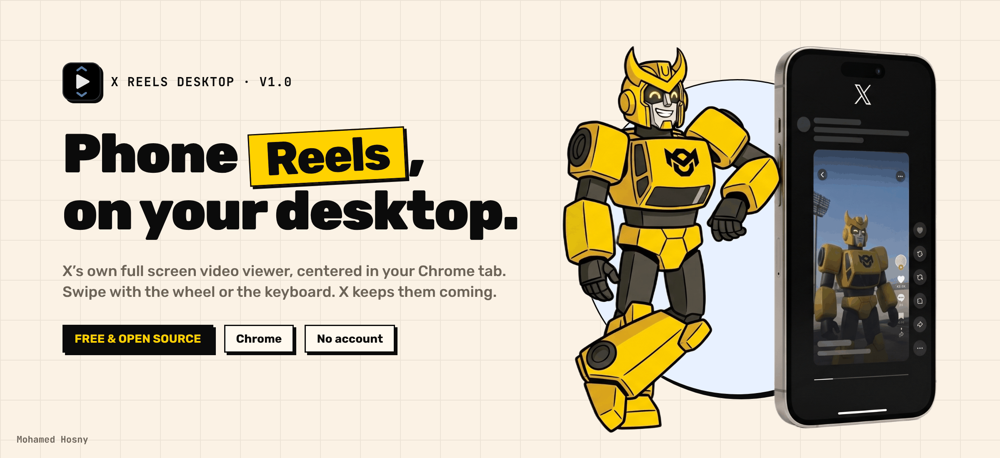
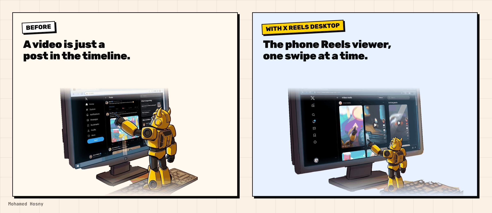
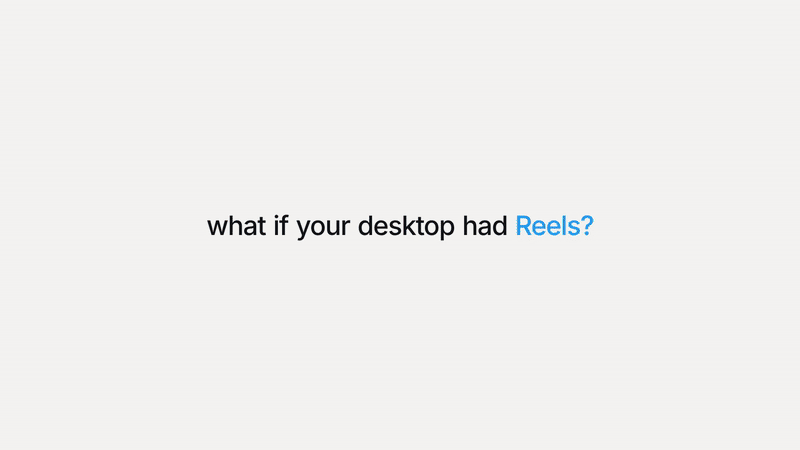
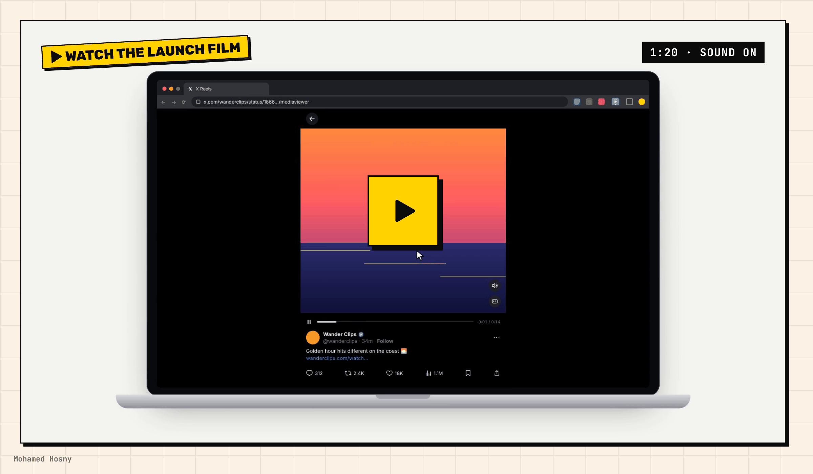
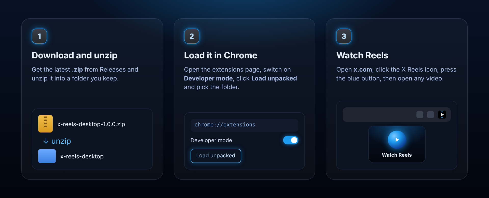
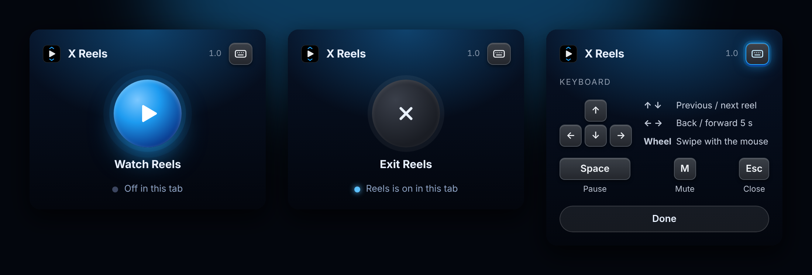
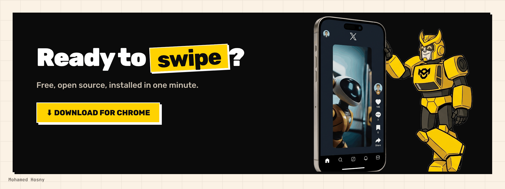

<p align="center">
  
</p>

<p align="center">
  <a href="../../releases/latest"></a>
  
  
  <a href="../../actions/workflows/tests.yml"></a>
</p>

<p align="center">
  <a href="../../releases/latest"><b>⬇️ Download for Chrome</b></a> &nbsp;·&nbsp;
  <a href="https://github.com/Eng-MohamedHosny/x-reels-desktop/releases/download/v1.0.0/x-reels-launch.mp4"><b>▶️ Watch the launch film</b></a> &nbsp;·&nbsp;
  <a href="#install"><b>Install in 1 minute</b></a>
</p>

---

## 🤳 Why X Reels Desktop?

On the X phone app, tapping a video opens a full screen player. You swipe up, the next video plays, and X keeps suggesting more. On a computer you don't get that: videos play small inside the timeline, and you scroll past posts to find the next one.

**X Reels Desktop brings the phone experience to your computer.** One click, and your X tab switches to the same Reels viewer the phone uses, centered on your screen. Swipe with the mouse wheel or the keyboard, and X keeps the videos coming.

<p align="center">
  
</p>

## ▶️ See it in action

<p align="center">
  
</p>

<p align="center">
  <a href="https://github.com/Eng-MohamedHosny/x-reels-desktop/releases/download/v1.0.0/x-reels-launch.mp4">
    
  </a>
  <br><sub>Click to watch the full 1:20 launch film.</sub>
</p>

## What you get

- **The real X Reels viewer.** X's own player and X's own recommendations, not a copy.
- **Centered and clean.** The player sits in the middle of your tab, like a phone on your desk.
- **A smooth wave** with a soft blue glow when you switch Reels on and off.
- **Easy controls.** Mouse wheel or arrow keys to move between videos, Space to pause, M to mute.
- **Only where you want it.** It works only in the tab you turn it on. Your other X tabs stay normal.
- **Light and private.** No account, no tracking, nothing leaves your browser.

## Install

It is not on the Chrome Web Store yet, so you add it yourself. It takes a minute:

<p align="center">
  
</p>

1. Download **`x-reels-desktop-1.0.0.zip`** from the [latest release](../../releases/latest) and unzip it. You get a folder called `x-reels-desktop`. Keep it somewhere safe.
2. In Chrome, open `chrome://extensions`, turn on **Developer mode** (top right), click **Load unpacked**, and choose the unzipped folder.
3. Pin the X Reels icon to your toolbar so it is always one click away.

> Keep the folder after installing. Chrome loads the extension from it, so deleting or moving the folder removes the extension.

## How to use

<p align="center">
  
</p>

1. Open **x.com** in a tab.
2. Click the X Reels icon and press the blue button. The page reloads in Reels mode, and the toolbar icon turns blue so you know it is on.
3. Open any video and start swiping.
4. To go back to normal X, click the icon and press the button again.

### Keyboard shortcuts

| Key | Action |
| --- | --- |
| <kbd>↓</kbd> or <kbd>J</kbd> | Next video |
| <kbd>↑</kbd> or <kbd>K</kbd> | Previous video |
| <kbd>←</kbd> / <kbd>→</kbd> | Back / forward 5 seconds |
| <kbd>Space</kbd> | Play / pause |
| <kbd>M</kbd> | Mute / unmute |
| <kbd>Esc</kbd> | Close the video |

The mouse wheel moves between videos too. You can see the shortcuts anytime from the keyboard button in the popup.

## Browser support

| Browser | Status |
| --- | --- |
| Google Chrome (Windows, macOS, Linux) | ✅ Supported and tested |
| Microsoft Edge and other Chromium browsers | Should work, not tested yet |
| Brave | ❌ Not supported: its built-in protections block what the extension needs |
| Firefox, Safari | ❌ Not supported |

## Privacy and permissions

X Reels Desktop has no server and collects nothing. Everything happens inside your browser.

| Permission | Why it is needed |
| --- | --- |
| Access to `x.com` and `twitter.com` | To switch the tab you choose to the phone version of X |
| Access to `twimg.com` | X loads its videos and images from there |
| Storage | To remember which tabs have Reels turned on |

The extension does nothing in a tab until you press the button in that tab. Closing the tab or leaving X turns it off.

## Questions

**Is this an official X app?**
No. It is an independent open source project, not made by or connected to X Corp.

**Do I need to sign in to anything?**
No. Use X as you normally do. The extension needs no account.

**Nothing changed, or videos still look small.**
Check that the toolbar icon is blue, then reload the tab. If you use Brave, try Chrome.

**How do I update?**
Download the new zip from Releases, replace the files in your folder, then click the reload arrow on the extension card in `chrome://extensions`.

## For developers

<details>
<summary>How it works, and how to run the tests</summary>

<br>

X serves its Reels viewer only to phones. When you turn the extension on in a tab, it:

- Asks X for the phone version of the site in that tab only, with Chrome's `declarativeNetRequest` rules sending an Android browser identity.
- Makes the page report the same phone identity, and a phone sized width so the player stays centered.
- Keeps X's offline cache (service worker) out of the way in that tab, so the desktop version is not served from cache.

No `chrome.debugger`, no remote code, and no change to other tabs.

| File | Role |
| --- | --- |
| `manifest.json` | Extension manifest (Manifest V3) |
| `background.js` | Turns Reels on and off per tab, sets the toolbar icon |
| `shims.js`, `page-shim.js` | Phone identity and centered layout inside the page |
| `fx.js` | The wave animation when Reels turns on or off |
| `controls.js` | Keyboard and mouse wheel controls |
| `popup/` | The toolbar popup |
| `tests/` | Unit tests and an end to end test against a mock x.com |

```bash
node --test tests/background.test.cjs tests/controls.test.cjs
./scripts/build-zip.sh   # builds x-reels-desktop-<version>.zip with only the extension files
xvfb-run -a -s "-screen 0 1920x1080x24" node tests/e2e/mock-x.e2e.cjs   # needs Playwright + Chromium
```

**Releasing.** Bump `version` in `manifest.json`, add `.github/RELEASE_NOTES_v<version>.md`, then push a tag (`git tag v1.0.1 && git push origin v1.0.1`). The Release workflow runs the tests, builds the zip with `scripts/build-zip.sh` and publishes the GitHub release.

</details>

## License

[MIT](LICENSE) © 2026 Mohamed Hosny

<p align="center">
  <a href="../../releases/latest"></a>
</p>

<p align="center">Made with 💛 by <b>Mohamed Hosny</b></p>
